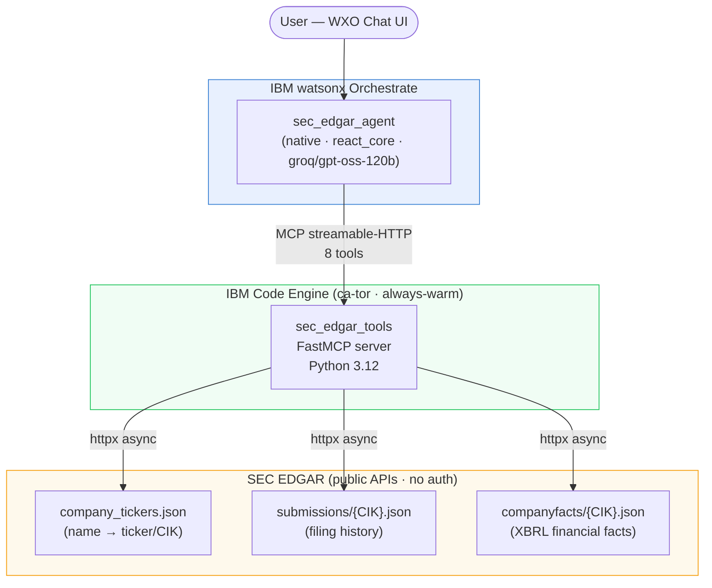

# SEC EDGAR Facts Explorer — Hackathon Submission

**Author:** Michael Schihl  
**Environment:** IBM watsonx Orchestrate — `gsa-hackathon` (IBM Cloud Toronto, `ca-tor`)  
**Submission date:** 2026-11-14  
**Last updated:** 2026-11-18

---

## Problem Statement

Public company financial data is authoritative, machine-readable, and freely
available via the SEC's EDGAR APIs — yet it is almost never used directly in
AI-powered workflows. Financial chatbots typically answer from training data
(which is stale, unverifiable, and prone to confabulation) or from expensive
third-party data providers. Neither approach gives the user a path back to the
primary source.

This project asks a simple question: **can a watsonx Orchestrate agent answer
real financial questions by querying the SEC's authoritative APIs directly —
with every number traceable back to the SEC filing that reported it?**

The answer, demonstrated across 23 evaluation questions, is yes. The agent
enforces this structurally: every financial figure in a response must come from
a tool return value. The agent instructions explicitly prohibit constructing or
guessing URLs, stating values from memory, or answering financial questions
without a tool call. No code path exists that returns a number from training data.

---

## What Was Built

Three connected layers, each building on the previous:



### Layer 1 — MCP Server (`sec_edgar_tools`)

An 8-tool FastMCP server deployed to IBM Code Engine as an always-warm
containerised HTTPS service. It exposes the SEC's three public data endpoints
as structured tool calls. No API keys are required — EDGAR is fully open.

The server connects to watsonx Orchestrate as a remote MCP toolkit over the
`streamable_http` transport, replacing the earlier stdio/subprocess model and
making the toolkit reachable by any MCP-compatible client.

**The 8 tools:**

| # | Tool | Purpose |
|---|------|---------|
| 1 | `sec_edgar_search_companies` | Find companies by partial name; returns ticker, CIK, full name |
| 2 | `sec_edgar_resolve_company` | Resolve a ticker or CIK to canonical SEC identity (SIC, state, CIK) |
| 3 | `sec_edgar_get_recent_filings` | List recent 10-K, 10-Q, 8-K or any form type, most-recent-first |
| 4 | `sec_edgar_get_company_fact` | Fetch a multi-year XBRL fact time series (e.g. 8 years of net income) |
| 5 | `sec_edgar_get_quarterly_facts` | Fetch single-quarter XBRL observations (Q1/Q2/Q3 from 10-Qs; Q4 derived as annual minus nine-month YTD for USD flow concepts) |
| 6 | `sec_edgar_compare_companies` | Compare one concept across multiple companies; emits FY-alignment warnings |
| 7 | `sec_edgar_list_concepts` | Enumerate XBRL concepts a company reports; supports keyword search |
| 8 | `sec_edgar_get_filing_metadata` | Resolve an accession number to form type, dates, and a direct EDGAR link |

### Layer 2 — Agent (`sec_edgar_agent`)

A native watsonx Orchestrate agent (`react_core` style, `groq/gpt-oss-120b`)
with a detailed instruction set covering:

- **Tool selection rules** — which tool to call for each class of question
- **Multi-step chaining** — search → resolve → retrieve for name-based queries
- **Concept synonyms** — XBRL tag names are non-obvious; the agent tries alternate
  names and runs synonym searches when a concept is not found
- **Comparability warnings** — always surface fiscal-year misalignment to the user
- **Q4 derived values** — Q4 rows computed as annual minus nine-month YTD are labelled
  `(derived)`; EPS and balance-sheet concepts that cannot be derived include an explanation
- **Source traceability** — every response must state the value itself before citing
  the filing; all URLs must come from tool return values, never constructed by the agent

### Layer 3 — Evaluation Harness

Two evaluation frameworks measuring different quality dimensions:

**REST evaluator** (`evaluation/run_evaluation.py`): sends questions to the
live agent over the WXO REST API, checks which tools fired (via text matching on
response content), and compares against expected tool lists. Note: routing counts
derived from text matching are estimates — they do not inspect WXO's internal
tool-call event stream.

**Phoenix LLM-as-judge** (`eval/phoenix/`): an Arize Phoenix harness with two
modes: (a) *Llama-agent runs* where `meta-llama/llama-3-3-70b-instruct` acts as
both agent and judge via the Code Engine MCP endpoint directly; and (b) *production
scoring* where cached responses from the live WXO agent are scored by
`mistralai/mistral-small-3-1-24b-instruct-2503` with a 3-vote majority per question.

---

## Evaluation Results

### Layer 1 — Tool Routing (automated, 2026-11-07)

**20 / 20 questions passed** the routing check. Every expected tool fired; no
question was answered from the LLM's training data.

> **Methodology note:** Routing was detected by text matching on agent response
> content, not from WXO's internal tool-call event stream. Fire rates above 100%
> are estimates reflecting correct retry and validation behaviour visible in the
> response text.

| Tool | Questions | Times Fired | Notes |
|------|-----------|-------------|-------|
| `sec_edgar_search_companies` | 4 | 4 | 100% — exact routing |
| `sec_edgar_resolve_company` | 2 | ~8 | ~400% — agent proactively validates tickers (text-match estimate) |
| `sec_edgar_get_recent_filings` | 4 | 4 | 100% |
| `sec_edgar_get_company_fact` | 5 | ~6 | ~120% — retries with alternate concept names (text-match estimate) |
| `sec_edgar_compare_companies` | 2 | ~3 | ~150% — retries on stale concept data (text-match estimate) |
| `sec_edgar_get_quarterly_facts` | 3 | 3 | 100% |
| `sec_edgar_list_concepts` | 2 | 2 | 100% |
| `sec_edgar_get_filing_metadata` | 2 | 2 | 100% |

### Layer 2 — Human Quality Audit (2026-11-11)

A human review of all 20 agent responses against actual SEC EDGAR data found
seven response quality issues. All have been addressed.

**What the agent does well:**
- Consistent, clean table formatting across all 20 responses
- Proactive fiscal-year comparability warnings (fired correctly on 3 of 3 applicable comparisons)
- Tool-returned URLs only: agent instructions prohibit constructing or guessing EDGAR links
- Graceful error handling on invalid ticker (BQ-19): clear message, no fabrication
- Correct multi-step chaining for name-search → financial-data questions (BQ-17, BQ-18)

**Issues found and addressed:**

| Issue | Severity | Root cause | Resolution |
|-------|----------|------------|-----------|
| Wrong entity for multi-registrant corps (ExxonMobil shell vs. operating entity) | High | Search returned first alphabetical result | Agent ranks by `has_recent_10k=true` and `all_filers`; retries if no 10-K found |
| YTD values returned as quarterly figures (Apple Q3 ~$364B instead of ~$109B) | High | XBRL stores 3-month and 9-month values under the same `fp=Q3` label | Server: 80–100 day duration filter; deduplicates per `(start, end)` pair |
| Q4 figures not separately filed in 10-Qs | Medium | No 10-Q for Q4 | Server derives Q4 = annual FY − nine-month YTD for USD flow concepts; derived rows labelled `derived: true`; Rule 8 updated |
| Annual fact precision (~$3B off for Apple FY2024) | Medium | `get_company_fact` returned comparative-period restated entries | Server deduplicates by fiscal year end, keeping latest-filed entry per year |
| Concept synonym gaps (revenue/debt tags not matching keywords) | Medium | Substring search misses tags like `PremiumsEarnedNet` | Rule 7 updated: synonym searches; XBRL concept table expanded |
| Revenue concept selection (Pfizer using wrong concept, ~15% off) | Medium | `Revenues` vs. `RevenueFromContractWithCustomer...` selection not evaluated | Server evaluates `REVENUE_CANDIDATES` and picks concept with newest period end |
| Source filing URLs — risk of construction from memory | Medium | No explicit prohibition in earlier instructions | Rule 6 updated: value must be stated before filing details; URL construction prohibited; `filing_index_url` in every fact row |

### Layer 3 — LLM-as-Judge

#### Llama-agent Phoenix experiments (2026-11-17)

These experiments used `meta-llama/llama-3-3-70b-instruct` as **both the agent
and the judge**. The agent was driven directly from the Phoenix harness via the
Code Engine MCP endpoint — **not** via the production WXO environment. Results
reflect the Llama model's behaviour as an agent, not the production `gsa-hackathon`
WXO agent.

| Experiment | System Prompt | Correctness | Scope |
|---|---|---|---|
| Experiment 2 | v1 (baseline) | **17 / 20 = 85%** | **20 / 20 = 100%** |
| Experiment 3 | v2 (scope-bounded) | **18 / 20 = 90%** | **20 / 20 = 100%** |

#### Production WXO agent scoring (2026-11-18)

The production `sec_edgar_agent` on `gsa-hackathon` was scored against 23 benchmark
questions using `mistralai/mistral-small-3-1-24b-instruct-2503` as the judge with a
**3-vote majority** per question. Run date: 2026-11-18, against commit `571f523`.

| Dimension | Score | Notes |
|---|---|---|
| Correctness | **21 / 23** | 2 unstable (2-of-3 split): BQ-18, BQ-22 |
| Scope | **23 / 23** | Agent never answered out-of-scope questions from training data |
| Numeric | **8 / 8** | All 8 questions with numeric anchors pass within stated tolerance |

21 questions were unanimous (3-of-3 correct). The 2 unstable questions reflect judge
ambiguity on borderline cases (Exxon filing period-end dates near today; Tesla
investment-advice refusal completeness), not agent errors. No question was classified
incorrect.

**Root causes of remaining failures (Llama-agent runs):**

| Question | Root cause | Status |
|---|---|---|
| Apple quarterly revenue (8 quarters) | Agent got error on `Revenues` concept and did not retry with `RevenueFromContractWithCustomerExcludingAssessedTax` for the quarterly tool | Fixed in server: `REVENUE_CANDIDATES` auto-selection |
| JPM vs BAC total assets | Correct values returned but fiscal year end dates omitted | Fixed: production agent includes period-end dates |
| Exxon search → resolve → 10-K filings | Agent resolved to ExxonMobil Holdings Corp (a shell with no 10-K filings) | Fixed in agent instructions (Rule 1): `has_recent_10k` ranking |

---

## Key Technical Decisions

**Remote MCP over stdio.** The toolkit runs as a persistent HTTPS service on
Code Engine rather than as a subprocess inside WXO. This means: (1) the server
is always warm — no cold-start latency per request; (2) the toolkit is
independently versioned from the agent; (3) any MCP-compatible client can connect
to it without touching the WXO environment.

**FastMCP with async httpx.** All 8 tools are async, sharing a single persistent
`httpx.AsyncClient` with `trust_env=False` and `follow_redirects=True`. A single
warm client handles all concurrent requests without connection churn. The SEC
enforces a ~10 req/s rate limit; the `compare_companies` tool adds a 120ms delay
between companies to stay within it.

**Duration-based quarterly filter.** The SEC XBRL API does not distinguish
3-month from 9-month periods at the response level — both carry `fp=Q3`. The fix
computes `end − start` for each observation and accepts only 80–100 day windows as
single quarters. YTD values (180–280 days) are excluded. This is a data-level fix in
the server, invisible to the agent and to the user.

**Q4 derivation.** Because companies do not file a 10-Q for Q4, the server derives
Q4 as `annual FY value − nine-month YTD value` when both a 350–380 day 10-K record
and a 260–285 day fp=Q3 record share the same `period_start`. Derived rows carry
`derived: true` and a note with both source accession numbers. Per-share units and
instant (balance-sheet) facts are excluded from derivation with an explanatory note.

**Server-side revenue concept selection.** Both `sec_edgar_get_company_fact` and
`sec_edgar_get_quarterly_facts` evaluate all revenue concept candidates
(`Revenues`, `RevenueFromContractWithCustomerExcludingAssessedTax`, and others) and
return the one whose most recent period end date is newest. The effective concept
name is included in the response so the agent and user can see which tag was used.

**Deterministic EDGAR URLs.** Every fact row includes a `filing_index_url` computed
directly from the accession number and CIK — no extra HTTP call required. The agent
instructions prohibit constructing or guessing URLs; every URL in a response must
come from a tool return value.

**3-vote majority judge.** The correctness judge calls the LLM three times per
question independently and awards the majority label. A 2-of-3 split is reported as
"unstable" with score 0.5. This reduces single-inference flip-flopping and makes
the correctness signal more reliable.

---

## Phoenix Experiment — Summary

The LLM-as-judge runs provided two complementary quality signals:

1. **Llama-agent Phoenix (2026-11-17):** 17–18/20 correctness, 100% scope across
   two prompt versions, using Llama-3.3-70B as both agent and judge directly on the
   Code Engine MCP endpoint. Identified three failures, all since fixed.

2. **Production WXO agent scoring (2026-11-18, commit `571f523`):** 21/23 correct
   (2 unstable: BQ-18, BQ-22), 23/23 scope, 8/8 numeric, using Mistral Small
   3-vote majority judge on cached production responses. The 21 unanimous-correct
   questions span all 8 tools and all difficulty levels. No question was scored incorrect.

3. **Scope: 23/23 (100%)** in production scoring — the agent never answered
   out-of-scope questions (stock prices, forecasts, investment advice) from
   training data. This holds across both the Llama-agent and production runs.

4. **Numeric anchors: 8/8 (100%)** — eight questions have specific dollar values
   as must-include checks (e.g. AAPL revenue ~$478.8B, MSFT net income ~$133.7B,
   MSFT Q4 FY2026 derived ~$35.8B). All pass within 0.5% tolerance.

5. **Per-question traces** are viewable in the Phoenix UI
   (http://localhost:6006) → Datasets → `sec-edgar-eval-2`.

---

## Running the Demo

The agent is live and can be used without any setup:

**IBM watsonx Orchestrate → Chat → `sec_edgar_agent`**

A fully scripted 8-step demo walkthrough is at [`docs/demo_walkthrough.md`](demo_walkthrough.md).
It covers every tool, includes exact prompts, expected responses drawn from the
live eval run, and talking points for each step. Estimated run time: 8–10 minutes.

**Quick starter prompts:**
```
Show me the last 5 annual net income figures for Apple.
Compare annual net income for AAPL, MSFT, and GOOGL.
Show me Apple's quarterly revenue for the last 8 quarters.
Which SEC filing reported Apple's most recent annual revenue?
Find all companies with "Berkshire" in their name.
What revenue-related XBRL concepts does Apple report?
```

---

## Milestones

| Milestone | Status |
|-----------|--------|
| M1 — 8-tool MCP server built and deployed to Code Engine | ✅ Complete |
| M2 — Agent deployed to WXO; toolkit re-imported as remote streamable-HTTP | ✅ Complete |
| M3 — Evaluation: REST run (20/20 routing), human audit, Phoenix LLM-as-judge (17–18/20 Llama-agent; 21/23 correct + 2 unstable production WXO, 23/23 scope, 8/8 numeric) | ✅ Complete |

---

## Repository Layout

```
toolkits/sec_edgar_tools/
├── server.py              ← FastMCP server (8 tools)
├── requirements.txt       ← pinned: fastmcp==4.1.3, httpx==0.28.1, pydantic==2.14.3
├── toolkit.yaml           ← WXO import spec (remote MCP, streamable_http)
└── test_regressions.py    ← 80+ regression assertions (live SEC APIs)

agents/
└── sec_edgar_agent.yaml   ← native react_core agent definition

evaluation/
├── run_evaluation.py      ← REST-based tool-routing evaluator
├── benchmark_questions.py ← 23 benchmark questions with pass criteria and numeric checks
├── EVAL_REPORT.md         ← full 23-question results
├── response_quality_audit.md  ← human annotations of all 20 responses
└── interpretation.md      ← narrative evaluation report (updated 2026-11-18)

eval/phoenix/
├── create_dataset.py      ← uploads CSV to Phoenix dataset store
├── run_experiment.py      ← runs LLM-as-judge experiment (Llama-agent mode)
├── score_wxo_results.py   ← scores cached WXO responses with majority-vote judge
├── build_dataset.py       ← builds sec-edgar-eval-2 CSV from benchmark_questions.py
├── judges/
│   ├── correctness_judge.py  ← 3-vote majority correctness judge
│   ├── relevance_judge.py    ← scope judge
│   ├── numeric_judge.py      ← deterministic numeric anchor checker
│   └── sanity_check.py       ← 11-case judge sanity suite
└── datasets/sec-edgar-eval-2/  ← current 23-question evaluation dataset

docs/
├── project_overview.md    ← plain-language project summary
├── demo_walkthrough.md    ← scripted 8-step demo script
└── submission.md          ← this file
```

---

*Submitted: 2026-11-14 | Updated: 2026-11-18 | Author: Michael Schihl*
